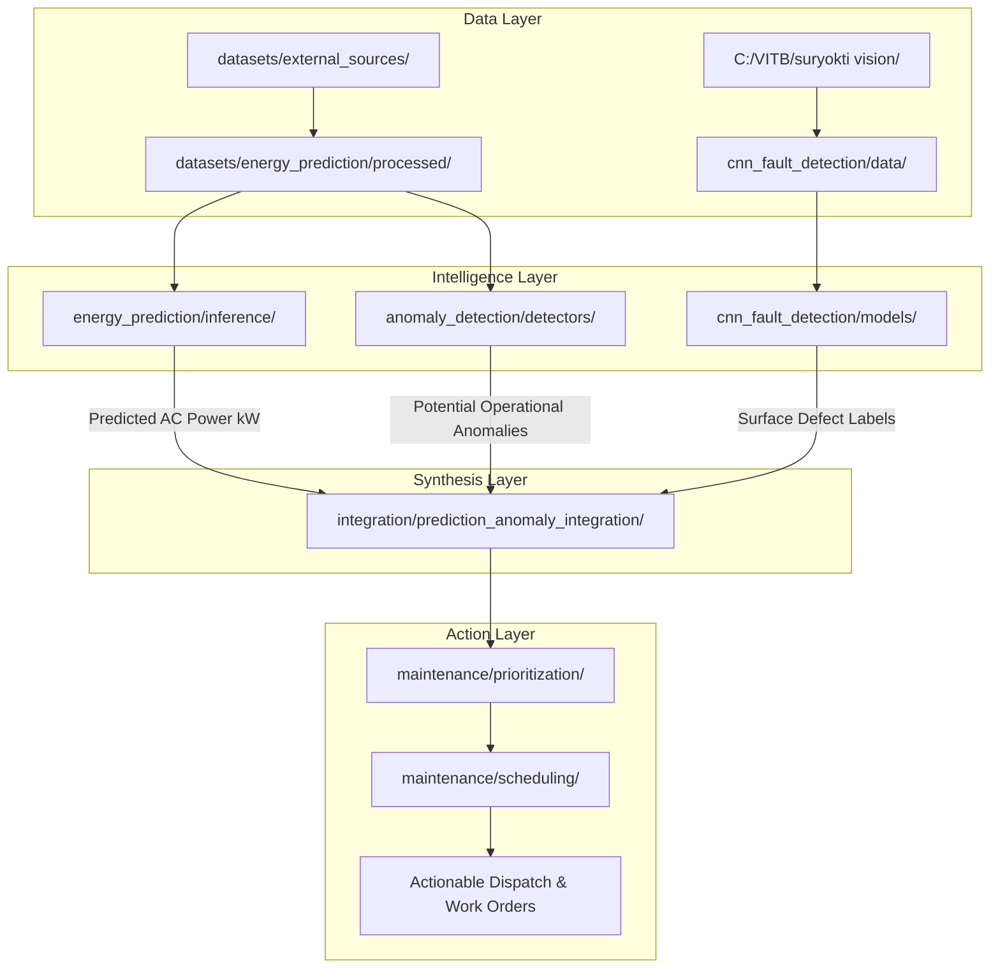

# SURYOKTI: Repository Structure and Historical Reorganization Notes

> [!IMPORTANT]
> The root [`README.md`](README.md) is the current source-of-truth map. The detailed tree below records the original reorganization design and may include legacy or locally retained paths that are intentionally excluded from Git. Do not use it as an execution guide.
>
> ```text
> datasets/                         Canonical reorganized CSVs
> energy_prediction/                Original demo forecasting workflow
> anomaly_detection/                Daylight-gated Isolation Forest workflow
> maintenance/ and integration/     Runnable triage workflow
> energy_prediction_romania/        Self-contained Romania implementation
> energy_prediction_adaptive/       Self-contained schema-adaptive implementation
> experiments/regional_adaptation/  Maui research; target remains unverified
> PV-Generation-Dataset-main/       Independent imported toolkit, not integrated
> Not Nec/                          Legacy and duplicate material, not active code
> ```
>
> The sections below are retained only to explain the original intended architecture and migration rationale.

---

## 1. Directory Tree Architecture

```text
SURYOKTI/ (Project Root)
│
├── README.md                                    # Master project introduction & quickstart guide
├── PROJECT_STRUCTURE.md                         # Complete structural directory blueprint (this file)
├── requirements.txt                             # Python package dependencies (UTF-8)
├── suryokti_hybrid.suryokti                     # Production hybrid XGBoost model package
├── isolation_forest_results.csv                 # Benchmark baseline anomaly detection results
│
├── datasets/                                    # Master repository datasets directory
│   ├── README.md                                # Dataset provenance, schema, and usage guide
│   ├── data_dictionary.csv                      # Column definitions, units, and descriptions
│   ├── energy_prediction/
│   │   ├── raw/                                 # Raw telemetry datasets (e.g. Maui 15-min)
│   │   ├── processed/                           # Feature-engineered & hourly aggregated CSVs
│   │   ├── demo_datasets/                       # Synthetic Kaggle merged demo dataset
│   │   └── final_datasets/                      # Production validated plant datasets
│   ├── anomaly_detection/
│   │   ├── raw/                                 # Raw sensor fault logs
│   │   ├── refined/                             # Nighttime filtered daylight observations
│   │   ├── processed/                           # Feature-scaled anomaly inputs
│   │   └── validation_datasets/                 # Scored anomaly benchmark results
│   ├── cnn_fault_detection/
│   │   ├── raw_images/                          # Pointer to external high-res inspection images
│   │   ├── processed_images/                    # Normalized 224x224 RGB image arrays
│   │   └── training_datasets/                   # Train/Val/Test splits and label manifests
│   ├── external_sources/
│   │   ├── kaggle/                              # Gandikota plant & HI-SEAS weather sources
│   │   └── nrel_pvdaq/                          # NREL PVDAQ System 2105 metadata & registry
│   └── unclassified/                            # Scratch or pending dataset files
│
├── energy_prediction/                           # Solar PV AC Power Output Forecasting Module
│   ├── README.md                                # Energy prediction pipeline documentation
│   ├── requirements.txt                         # Energy prediction dependencies
│   ├── data/                                    # Preprocessing and cleaning scripts
│   ├── training/                                # Training scripts (Linear, RF, XGB, Stacking)
│   ├── evaluation/                              # Model comparison, K-Fold & TimeSeries CV
│   ├── testing/                                 # Suryokti model package verification
│   ├── inference/                               # Standalone AC output forecasting inference
│   ├── models/                                  # Trained models, scalers, and schemas
│   ├── plots/                                   # Model comparison, parity, residuals, features
│   ├── results/                                 # Prediction CSVs and evaluation metrics
│   ├── notebooks/                               # Jupyter exploratory notebooks
│   └── scripts/                                 # Execution runners and automation tools
│
├── anomaly_detection/                           # Solar PV Sensor & Operational Anomaly Detection
│   ├── README.md                                # Anomaly detection architecture & methodology
│   ├── data/                                    # Data cleaning and zero-power investigations
│   ├── detectors/                               # Isolation Forest, MAD, and residual detectors
│   ├── training/                                # Calibration and threshold tuning scripts
│   ├── evaluation/                              # Daylight-gated anomaly evaluation
│   ├── testing/                                 # Unit verification and corner-case audits
│   ├── tracing/                                 # Solar irradiance vs power tracing utilities
│   ├── models/                                  # Exported anomaly model artifacts (.pkl)
│   ├── plots/                                   # Distributions, timelines, sensor diagnostics
│   ├── results/                                 # Scored anomaly CSVs and summary reports
│   ├── logs/                                    # Execution and calibration run logs
│   └── scripts/                                 # Detection runners and batch processors
│
├── cnn_fault_detection/                         # Visual PV Panel Surface Fault Identification
│   ├── README.md                                # CNN architecture, 6 fault classes, & data links
│   ├── data/                                    # Image manifests and dataset references
│   ├── models/                                  # CNN architecture definitions & weight references
│   └── plots/                                   # Class distribution, confusion matrices, filters
│
├── maintenance/                                 # Intelligent Solar Plant Maintenance Decision Engine
│   ├── README.md                                # Maintenance prioritization and scheduling logic
│   ├── scheduling/                              # Predictive inspection scheduling algorithms
│   ├── prioritization/                          # Fault severity and revenue-loss priority matrix
│   └── recommendation_logic/                    # Actionable cleaning and repair dispatch rules
│
├── integration/                                 # Integrated Workflow & End-to-End Orchestration
│   ├── README.md                                # Integration guide across prediction and anomalies
│   ├── prediction_anomaly_integration/          # Joint residual-anomaly fusion scripts
│   └── end_to_end_workflow/                     # Master pipeline orchestrating telemetry -> action
│
├── models/                                      # Central Trained Artifacts Store
│   ├── README.md                                # Model inventory, versioning, and provenance
│   ├── energy_prediction/                       # Best regressors, stacking ensembles, scalers
│   ├── anomaly_detection/                       # Calibrated Isolation Forests and MAD thresholds
│   └── archived_experiments/                    # Historical models and regional prototypes
│
├── plots/                                       # Central Graphical Visualizations Store
│   ├── README.md                                # Visual catalog of all project plots
│   ├── energy_prediction/                       # Actual vs predicted, parity, residuals
│   ├── anomaly_detection/                       # Anomaly timelines, reconciliation pie charts
│   └── project_overview/                        # Capacity benchmarks and candidate comparisons
│
├── documentation/                               # Comprehensive Technical & Academic Documentation
│   ├── README.md                                # Documentation directory index
│   ├── project_reports/                         # Target reconstruction & decision memos
│   ├── technical_audits/                        # Rigorous technical audits and validation reports
│   ├── methodology/                             # Solar physics equations and feature definitions
│   └── license/                                 # Data licenses and provenance notes
│
├── presentations/                               # Slides and Presentation Materials
│   ├── README.md                                # Presentation catalog and script instructions
│   ├── progress/                                # Interim progress update slide decks
│   ├── final/                                   # Final model selection and fine-tuning decks
│   └── scripts/                                 # Automated python-pptx presentation generators
│
├── experiments/                                 # Specialized Regional Research Experiments
│   ├── README.md                                # Regional adaptation & reconstruction guide
│   ├── regional_adaptation/                     # Maui NREL PVDAQ System 2105 adaptation pipeline
│   ├── target_reconstruction/                   # Inverter channel decomposition & candidate models
│   └── archived/                                # Deprecated and historical exploratory runs
│
├── archive/                                     # Preservation of Bundles & Historical Artifacts
│   ├── README.md                                # Archive description and duplicate resolution
│   ├── bundles/                                 # Full project zip and dataset zip archives
│   └── duplicate_candidates/                    # Duplicate file inventory and hash mappings
│
└── Not Nec/                                     # Isolated Storage for Obsolete & Duplicate Files (472 MB)
    ├── README.md                                # Manifest of moved files and safety instructions
    ├── All_Datasets/                            # Redundant flat copy (now cleanly in datasets/)
    ├── SURYOKTI_Full_Project.zip                # Root zip duplicate (canonical in archive/bundles/)
    ├── SURYOKTI_All_Datasets.zip                # Root zip duplicate (canonical in archive/bundles/)
    ├── experiments_target_reconstruction/       # Duplicate folder (canonical in experiments/regional_adaptation/)
    ├── experiments_regional_adaptation_data/    # Duplicate telemetry (canonical in datasets/ & maui/data/)
    └── [Legacy Pre-Reorganization Folders]      # Original Kaggle, Anomaly, Prediction Analysis, etc.
```

---

## 2. Module Responsibilities and Boundaries

| Module | Core Purpose | Primary Inputs | Key Outputs |
|---|---|---|---|
| `datasets/` | Centralized data storage with strict source provenance | Raw CSVs, telemetry files, Kaggle archives | Model-ready, cleaned, normalized CSVs |
| `energy_prediction/` | Predicts AC power output (kW) using ML and physics features | Hourly solar weather features (GHI, Temp, Wind, Solar Angles) | Forecasted AC power, MAE/RMSE/R² metrics |
| `anomaly_detection/` | Flags sensor drift, operational faults, and zero-power events | Daylit telemetry, model residuals, irradiance | Anomaly flags, category breakdown, timelines |
| `cnn_fault_detection/` | Identifies visual panel degradation (dust, bird drops, physical) | RGB panel inspection imagery (`C:\VITB\suryokti vision`) | Classified fault category and severity score |
| `maintenance/` | Converts predictions and anomalies into actionable tasks | Expected loss (kW), anomaly confidence, visual fault | Work order schedule, priority ranking, dispatch |
| `integration/` | Bridges forecasting, anomaly scoring, and maintenance | Live plant telemetry stream | Unified dashboard data stream and alerts |
| `models/` | Immutable store for reproducible model artifacts | Trained estimator objects, scalers, encoders | Serialized `.pkl`, `.suryokti`, `.json` |
| `plots/` | Publication-ready visual assets | Benchmark evaluations, residual distributions | High-resolution PNG figures (150-300 DPI) |
| `documentation/` | Scientific rigor, audit trails, and transparency | Analytical findings, verification scripts | Peer-reviewable Markdown and JSON reports |
| `presentations/` | Stakeholder briefings and slide automation | Experimental results, metrics, diagrams | Automated `.pptx` decks and visual summaries |
| `experiments/` | Isolated scientific sandboxes (e.g., Maui adaptation) | Raw multi-channel PVDAQ telemetry | Audit reports, candidate benchmarks, memos |
| `archive/` | Historical preservation without cluttering root | Consolidated backups, duplicate candidates | Portable `.zip` bundles and audit logs |

---

## 3. Data Flow and Inter-Module Integration



---

## 4. Migration & Compatibility Invariants

1. **Zero Data Loss:** All 18 raw and processed datasets from original directories remain intact in `datasets/` and original locations.
2. **Backward Compatibility:** All reorganized scripts feature dynamic multi-path resolution (`Path(__file__).resolve().parents[...]`) allowing execution both from the root workspace and from within sub-directories.
3. **Strict Terminology:** Unverified anomalies are formally classified as `POTENTIAL_OPERATIONAL_ANOMALY` or `STATISTICAL_RESIDUAL_EXCEEDANCE` rather than unvalidated physical faults.
4. **Plant Capacity Status:** Maui plant AC output reconstruction remains objectively designated as `UNVERIFIED` pending site single-line electrical schematics.

