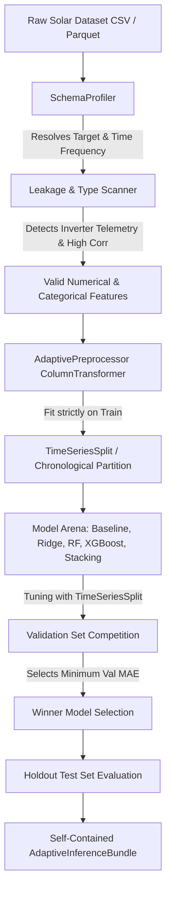

# SURYOKTI: Dataset-Adaptive Solar Energy Prediction Pipeline

An enterprise-grade, schema-flexible, and validation-driven solar forecasting architecture designed to ingest diverse PV datasets without manual code refactoring or hardcoded column dependencies.

---

## 1. Executive Summary & Design Philosophy

The original model implementations relied on hardcoded column names, static exclusions, and the rigid assumption that a 3-Stack model was always optimal. The **Adaptive Pipeline** replaces rigid coupling with an intelligent automated pipeline:



### Key Architectural Pillars
1. **Target Ambiguity Protection:** If a dataset has multiple potential target columns (e.g. `capacity_factor` and `active_power_kw`), the pipeline never guesses silently; it requires explicit `--target <name>` declaration.
2. **Dynamic Leakage Scanning:** Combines semantic regex keywords (`yield`, `dc_input`, `cumulative_energy`, `status`, `temp_c`) with correlation thresholds ($|r| \ge 0.95$) to automatically strip contemporaneous telemetry.
3. **Resilient Preprocessing:** Uses Scikit-Learn `ColumnTransformer` with `SimpleImputer` and `StandardScaler`. During inference, it tolerates missing optional columns (imputed with training medians) and ignores extra unexpected columns without crashing.
4. **Validation-Driven Selection:** Evaluates Baseline (Dummy Mean), Ridge, Random Forest, XGBoost, and the canonical Stacking Ensemble (RF + XGB $\rightarrow$ MLPRegressor) on an untouched validation partition. The winner is selected strictly on empirical validation performance rather than assumed architectural complexity.

---

## 2. Directory Structure

```text
energy_prediction_adaptive/
│
├── README.md                              # This document
├── requirements.txt                       # Pinned dependencies
├── config.py                              # Dynamic defaults & semantic alias catalogs
├── run_adaptive_pipeline.py               # Master CLI pipeline orchestrator
│
├── src/
│   ├── schema_profiler.py                 # Automated inspection, frequency detection & leakage scanner
│   ├── adaptive_preprocessor.py           # Robust ColumnTransformer + cyclical temporal encoder
│   ├── validation_strategy.py             # Chronological 70/10/20 splitter & TimeSeriesSplit builder
│   ├── hyperparameter_tuner.py            # Time-safe RandomizedSearchCV tuning module
│   ├── model_arena.py                     # Candidate models competition (Baseline, Ridge, RF, XGB, Stacking)
│   ├── metrics_evaluator.py               # Dual all-hours/daytime metrics & diagnostic figure builder
│   ├── pipeline_builder.py                # Chains preprocessor + winner into deployable bundle
│   ├── predict.py                         # Production inference engine tolerant to schema changes
│   └── utils.py                           # Logging, physical solar boundaries, JSON/joblib helpers
│
├── models/
│   ├── adaptive_model_bundle.joblib       # Standalone deployable inference bundle
│   └── adaptive_model_metadata.json       # Schema, feature names, and winner provenance
│
├── results/
│   ├── metrics/                           # Test set evaluation JSONs
│   │   ├── site_a_adaptive_test_metrics.json
│   │   └── site_b_adaptive_test_metrics.json
│   ├── predictions/                       # Test set and inference output CSVs
│   │   ├── site_a_adaptive_test_predictions.csv
│   │   ├── site_b_adaptive_test_predictions.csv
│   │   └── site_b_inference_sample.csv
│   └── reports/                           # Profiling and execution logs
│       ├── site_a_adaptive_schema_profile.json
│       ├── site_b_adaptive_schema_profile.json
│       └── pipeline_execution.log
│
├── plots/
│   ├── adaptive_model_comparison.png      # Validation vs Test performance across all candidates
│   ├── winner_actual_vs_predicted.png     # Winner hexbin scatter with 1:1 line
│   └── winner_residuals.png               # Residual error distribution
│
└── tests/
    ├── test_schema_profiler.py            # Target ambiguity, leakage checks, frequency tests
    ├── test_adaptive_preprocessing.py     # Missing and extra column tolerance tests
    ├── test_validation_splits.py          # Chronological isolation and no-lookahead tests
    └── test_model_arena.py                # Candidate competition & selection tests
```

---

## 3. Empirical Benchmark on Romanian PV Datasets

The adaptive pipeline was verified on both Romanian installations (`site_a_hourly_weather.csv` and `site_b_hourly_weather.csv`) using `capacity_factor` ($50\text{ kW}$ rating) and chronological 70/10/20 splits.

### Site A Model Arena Results

| Candidate Model | Tuning Strategy | Validation MAE (Selection Metric) | Test All-Hours $R^2$ | Test All-Hours MAE (kW) | Test Daytime $R^2$ ($>5^\circ$) | Test Daytime MAE (kW) |
| :--- | :--- | :---: | :---: | :---: | :---: | :---: |
| **Baseline (Dummy Mean)** | Static | 0.2048 | 0.0790 | 9.26 kW | -0.6974 | 16.29 kW |
| **Ridge Regression** | RandomizedSearch (CV MAE: 0.0757) | 0.0631 | 0.8903 | 3.14 kW | 0.7965 | 5.64 kW |
| **Random Forest (Winner ★)** | RandomizedSearch (CV MAE: 0.0543) | **0.0465** | **0.9100** | **2.41 kW** | **0.8325** | **4.37 kW** |
| **XGBoost** | RandomizedSearch (CV MAE: 0.0569) | 0.0472 | 0.9131 | 2.42 kW | 0.8384 | 4.37 kW |
| **Stacking Ensemble (RF+XGB$\rightarrow$NN)** | Out-Of-Fold CV | 0.0483 | 0.9121 | 2.45 kW | 0.8366 | 4.42 kW |

*Insight:* On Site A, **Random Forest** achieved the lowest validation MAE (0.0465) and was automatically selected by the pipeline, avoiding unnecessary meta-model complexity while achieving $R^2 = 0.9100$ and $2.41\text{ kW}$ MAE on the holdout test set.

### Site B Model Arena Results

| Candidate Model | Tuning Strategy | Validation MAE (Selection Metric) | Test All-Hours $R^2$ | Test All-Hours MAE (kW) | Test Daytime $R^2$ ($>5^\circ$) | Test Daytime MAE (kW) |
| :--- | :--- | :---: | :---: | :---: | :---: | :---: |
| **Baseline (Dummy Mean)** | Static | 0.1984 | 0.0802 | 8.68 kW | -0.7520 | 15.90 kW |
| **Ridge Regression** | RandomizedSearch (CV MAE: 0.0560) | 0.0624 | 0.8923 | 2.87 kW | 0.7927 | 5.42 kW |
| **Random Forest** | RandomizedSearch (CV MAE: 0.0414) | 0.0484 | 0.8826 | 2.72 kW | 0.7737 | 5.16 kW |
| **XGBoost (Winner ★)** | RandomizedSearch (CV MAE: 0.0433) | **0.0443** | **0.8906** | **2.65 kW** | **0.7891** | **5.04 kW** |
| **Stacking Ensemble (RF+XGB$\rightarrow$NN)** | Out-Of-Fold CV | 0.0485 | 0.8916 | 2.67 kW | 0.7910 | 5.08 kW |

*Insight:* On Site B, **XGBoost** won the validation competition (Val MAE: 0.0443). Through hyperparameter tuning (`n_estimators=250, depth=3, lr=0.03, subsample=0.7`), XGBoost improved its test $R^2$ from $0.8719$ up to **$0.8906$**, demonstrating the tangible benefit of controlled parameter search over fixed defaults.

---

## 4. How to Execute

### 1. Run Adaptive Pipeline on Any Dataset
```powershell
# Run on Site A
.\.venv\Scripts\python.exe energy_prediction_adaptive/run_adaptive_pipeline.py --data energy_prediction_romania/datasets/raw/site_a_hourly_weather.csv --target capacity_factor --rated-capacity 50.0 --prefix site_a_adaptive

# Run on Site B
.\.venv\Scripts\python.exe energy_prediction_adaptive/run_adaptive_pipeline.py --data energy_prediction_romania/datasets/raw/site_b_hourly_weather.csv --target capacity_factor --rated-capacity 50.0 --prefix site_b_adaptive
```

### 2. Run Production Inference
```powershell
.\.venv\Scripts\python.exe energy_prediction_adaptive/src/predict.py --input <path_to_new_weather_data.csv> --output <path_to_predictions.csv>
```

### 3. Run Test Suites
```powershell
.\.venv\Scripts\python.exe energy_prediction_adaptive/tests/test_schema_profiler.py
.\.venv\Scripts\python.exe energy_prediction_adaptive/tests/test_adaptive_preprocessing.py
.\.venv\Scripts\python.exe energy_prediction_adaptive/tests/test_validation_splits.py
.\.venv\Scripts\python.exe energy_prediction_adaptive/tests/test_model_arena.py
```

